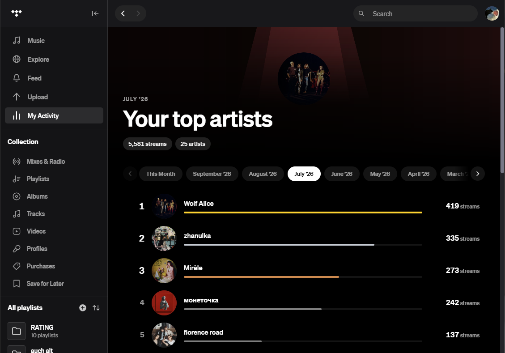
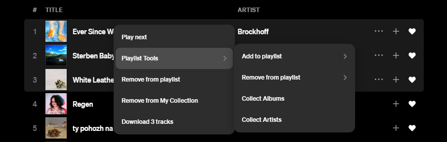
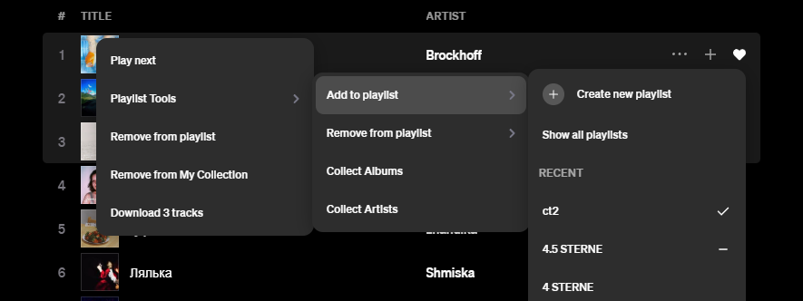
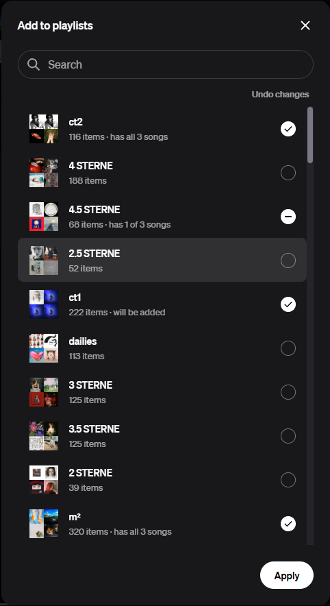
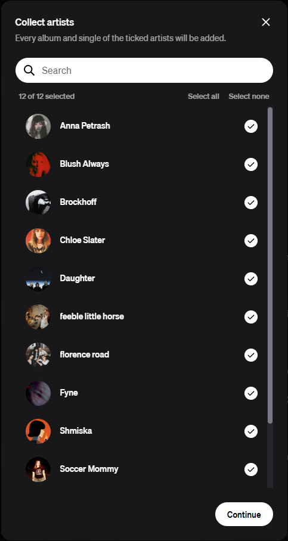
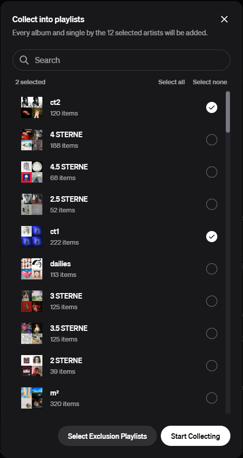
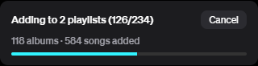

# Luna Plugins

A collection of plugins for [TidaLuna](https://github.com/Inrixia/TidaLuna), the client mod for the TIDAL desktop app.

| Plugin                    | What it does                                                                         |
|---------------------------|--------------------------------------------------------------------------------------|
| [Activity](#activity)     | Your monthly listening statistics from the TIDAL mobile app, now on desktop          |
| [Collector](#collector)   | Playlist tools: manage many playlists at once and collect complete albums or artists |
| [Comité](#comité)         | Rate every song from 0 to 5 stars, the way the old iPods did                         |
| [Librarian](#librarian)   | Download songs as FLAC files into a neatly organized music library                   |
| [Office](#office)         | A design overhaul for TIDAL: new queue, player, sidebar and search bar               |
| [Translator](#translator) | Translations beneath the lyrics, and which languages a playlist is in                |

All plugins are distributed through a single store. See [Installation](#installation).

---

## Activity

The TIDAL mobile app shows you what you listened to each month. Activity brings these statistics to the desktop.

- **My Activity tab:** A new *My Activity* tab in the sidebar opens your listening statistics.
- **Every month:** Browse through all past months and see how your taste changed.
- **Top artists:** See which artists you listened to most, and how often you streamed each of them.

<!-- TODO image: the "My Activity" tab in the sidebar -->
<!-- TODO image: the Activity page showing the month tabs and the list of top artists -->
<p align="center">
  
</p>

---

## Collector

Collector puts all your playlist tools in one place. Right-click a song, a selection of songs, an album or a playlist
and choose **Playlist Tools**.

<!-- TODO image: the right-click menu with "Playlist Tools" opened -->
<p align="center">
  
</p>

### Add and remove in one go

- **See where a song already is:** When adding a song, every playlist that already contains it is marked with a
  checkmark, so you never add a song twice by accident. Playlists that partially contain your selection are marked with
  a dash.

<p align="center">
  
</p>

- **Add to multiple playlists:** Tick as many playlists as you like and add the songs to all of them at once.
- **Remove from multiple playlists:** Untick playlists to remove the songs from all of them at once.

<p align="center">
  
</p>

### Collect albums and artists

Found a few songs you like? Let Collector get you the rest.

- **Collect Album(s):** Takes the songs you selected and adds the complete albums they come from to a playlist.
- **Collect Artist(s):** Takes the songs you selected and adds every album, EP and single of their artists to a
  playlist: complete discographies with one click.
- **No playlist limit:** TIDAL playlists hold at most 20,000 songs. When a playlist is full, Collector simply creates a
  new one and keeps going.
- **Exclusion playlists:** Choose playlists whose songs you never want collected. Those songs are left out, while the
  rest of their album is still added.

<!-- TODO image: the "Collect Album(s)" / "Collect Artist(s)" dialog with target playlists and the exclusion playlist option -->
<!-- TODO image: the progress notification while collecting, or the summary notification at the end -->
<p align="center">
  
  
</p>

<p align="center">
  
</p>

---

## Comité

Inspired by the rating system of the old click wheel iPods, Comité brings song ratings to TIDAL.

- **Rate every song:** Give any song from 0 to 5 stars, in half-star steps, right from the player or any track list.
- **See the averages:** Albums, artists and playlists show the average rating of their songs on their cover.
- **Your ratings everywhere:** Ratings are stored in your own TIDAL playlists, so they sync to all your devices.

<p align="center">
  
  
</p>

### Rating mode

Got a lot of unrated songs? Hit **Rate** on any album, playlist or artist and Comité plays its unrated songs one after
another, so you can rate as you listen. There are two rating modes:

- **Stars:** Pick a rating from 0 to 5 stars and the next song starts right away.
- **Higher / Lower:** Not sure how many stars a song deserves? Just compare it with songs you have already rated and
  pick the one you like more. Comité works out the rating for you.

<p align="center">
  
  
</p>

#### Keyboard shortcuts

| Mode           | Key                  | Action                                             |
|----------------|----------------------|----------------------------------------------------|
| Stars          | `1` to `5`           | Rate with that many stars                          |
| Stars          | `Shift` + `1` to `5` | Add a half star, for example `Shift` + `3` for 3.5 |
| Stars          | `S` or `→`           | Skip the song                                      |
| Higher / Lower | `←` / `→`            | The left (new) or right (rated) song is better     |
| Higher / Lower | `↓`                  | Can't decide                                       |
| Higher / Lower | `A` / `D`            | Listen to the left or right song                   |
| Higher / Lower | `S`                  | Skip the song                                      |
| Both           | `Space`              | Play / pause                                       |
| Both           | `Esc`                | End the session                                    |

### Settings

| Setting                   | Description                                                                                 |
|---------------------------|---------------------------------------------------------------------------------------------|
| Rating playlists          | The playlist that holds each rating, one for every half-star step from 0.5 to 5.            |
| Rating mode: start at (%) | Where each song starts in rating mode, so you can skip intros. 0 starts from the beginning. |

---

## Librarian

Librarian downloads your music from TIDAL and keeps it in a tidy local library. Right-click a song, a selection of
songs, an album or a playlist and choose **Download tracks**.

<p align="center">
  
</p>

- **FLAC files:** Songs are downloaded as `.flac` files.
- **Full metadata:** Every file comes with its title, artists, album, track number, lyrics, cover and more.
- **Fast:** Several songs download at the same time.
- **Organized library:** Songs are sorted into folders by artist and album (`Artist/Album/Title.flac`). The layout can
  be
  changed in the settings.
- **Only what's missing:** Librarian checks your library first and only downloads songs you don't have yet. Download a
  playlist again and you only get the new songs.

<p align="center">
  
</p>

### Settings

| Setting           | Description                                                                                                  |
|-------------------|--------------------------------------------------------------------------------------------------------------|
| Download quality  | The quality songs are downloaded in.                                                                         |
| Use RealMAX       | Looks for the highest-quality version of every song.                                                         |
| Downloads at once | How many songs download at the same time (1 to 8, default 4). Needs a default save path.                     |
| Default save path | The folder your library lives in. Downloads go there without asking, and songs you already have are skipped. |
| Path format       | How files are named and sorted into folders. Default: `{artist}/{album}/{title}`.                            |

---

## Office

Office is a design overhaul for TIDAL. It replaces the parts of the app that could look better. Every part can be turned
on or off in the settings.

<!-- TODO image: the full TIDAL window with all Office redesigns enabled (overview shot) -->
<p align="center">
  
</p>

### Redesigned queue

The play queue shows the current song large on its cover, what's coming up next and what you played recently, all
tinted in the colors of the current cover.

<!-- TODO image: the redesigned queue on the right side -->
<p align="center">
  
</p>

### Redesigned player

A cleaner player bar with a slim progress line along the top, the controls in the center and a horizontal volume slider.

<!-- TODO image: the redesigned player bar at the bottom of the window -->
<p align="center">
  
</p>

### Redesigned sidebar

The sidebar matches the queue: your playlists with their covers, and an animated equalizer next to the one that's
playing.

<!-- TODO image: the redesigned sidebar with playlist covers -->
<p align="center">
  
</p>

### Redesigned search bar

Search results open right next to the queue instead of in a separate window.

<!-- TODO image: the redesigned search bar with search results open -->
<p align="center">
  
</p>

### Pin what you need

Keep the sidebar, the navigation bar and the player always visible, even while the full-screen view is open.

<!-- TODO image: the full-screen view with the sidebar, navigation bar and player pinned -->
<p align="center">
  
</p>

### Settings

| Setting                 | Description                                                                    | Default |
|-------------------------|--------------------------------------------------------------------------------|---------|
| Redesigned play queue   | Replaces TIDAL's play queue with Office's version.                             | On      |
| Redesigned search       | Replaces TIDAL's search bar with Office's version. Needs the redesigned queue. | On      |
| Redesigned player bar   | Replaces TIDAL's player bar with Office's version.                             | On      |
| Redesigned sidebar      | Replaces TIDAL's sidebar with Office's version.                                | On      |
| Pinned player bar       | Stops the player bar from floating while the full-screen view is open.         | On      |
| Pinned cover            | Keeps the album cover in the player bar while the full-screen view is open.    | On      |
| Pinned sidebar          | Always keeps the sidebar visible.                                              | On      |
| Pinned navigation bar   | Always keeps the navigation bar visible.                                       | On      |
| Queue background tint   | Colors the queue's background with the cover of the current song.              | On      |
| Sidebar background tint | Colors the sidebar's background with the cover of the current song.            | Off     |

---

## Translator

Translator helps you understand songs in languages you don't speak.

- **Translated lyrics:** A translation appears beneath every line of the lyrics.
- **Your languages:** Choose the language to translate into, and which languages should never be translated, for example
  the ones you already speak.
- **Mixed-language songs:** Songs that switch between languages are supported. Each part is translated on its own.

<!-- TODO image: the lyrics view with translations beneath each line -->
<p align="center">
  
</p>

### Playlist languages

Curious which languages your playlist is in? Click **Languages** on any playlist to get a report showing how its songs
are spread across languages.

<!-- TODO image: the Languages report of a playlist with the language chart -->
<p align="center">
  
</p>

### Settings

| Setting         | Description                                                                                    |
|-----------------|------------------------------------------------------------------------------------------------|
| Target language | The language the lyrics are translated into. Defaults to your system language.                 |
| Never translate | Languages that are never translated, for example the ones you speak. Pick as many as you like. |

---

## Installation

Add the store to TidaLuna to install any of the plugins and receive updates automatically.

1. Open **Luna Settings**, then **Plugin Store**.
2. Choose **Install from URL**.
3. Enter the store URL:

```
https://github.com/marekvonrogall/luna-plugins/releases/download/latest/store.json
```

<p align="center">
  
</p>

## Development

Requires [Node.js](https://nodejs.org) and [pnpm](https://pnpm.io).

```sh
pnpm install
pnpm run watch   # rebuilds on change and serves ./dist on http://localhost:3000
pnpm run build   # production build into ./dist
```

Each plugin lives in its own folder under `plugins/`. Code shared between plugins, such as the playlist picker and the
progress notification, is in `shared/`.
