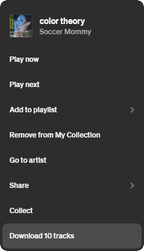
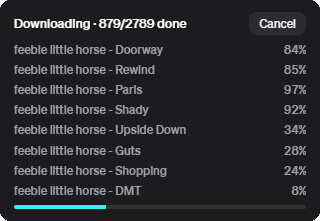
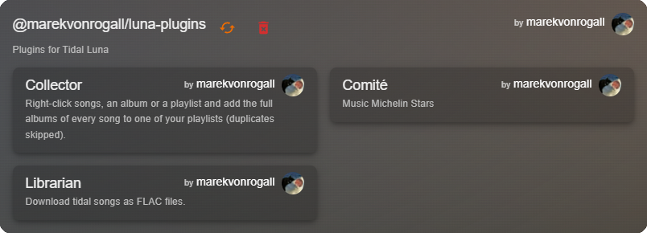

# Luna Plugins

A collection of plugins for [TidaLuna](https://github.com/Inrixia/TidaLuna), the client mod for the TIDAL desktop app.

| Plugin                    | Purpose                                                                                                               |
|---------------------------|-----------------------------------------------------------------------------------------------------------------------|
| [Comité](#comité)         | Half-star song ratings, stored in your own TIDAL playlists, with averages on every cover and a dedicated rating mode  |
| [Librarian](#librarian)   | Downloads songs, albums and playlists as tagged files into a structured local library, skipping what you already have |
| [Collector](#collector)   | Turns songs, playlists, artists or your whole collection into complete albums inside one playlist                     |
| [Translator](#translator) | Shows a translation under every line of the lyrics, and which languages a playlist is in                              |

All plugins are distributed through a single store. See [Installation](#installation).

---

## Comité

Inspired by the rating system of the old click wheel iPods, Comité brings song ratings to TIDAL.

Every song can be rated from half a star to five stars. Each of the ten rating steps is backed by a playlist of your
choosing: rating a song adds it to that playlist and removes it from the others. Because ratings live in ordinary TIDAL
playlists, they need no separate database, sync to all your devices, and remain usable in any TIDAL client, with or
without the plugin.

Ratings are shown wherever you browse: in the player, in track lists, and as average badges on album, playlist, and
artist covers.

<p align="center">
  
  
</p>

### Rating songs

There are three ways to rate a song:

- **Player bar:** Five stars next to the current song's title. Click the left half of a star for a half rating, the
  right half for a full one. When the player gets narrow, the stars collapse into a single button that opens them in a
  popover.
- **Rating column:** Track lists (albums, playlists, favorites, artist top tracks, search results) gain a *Rating*
  column that works the same way. It hides automatically when there is not enough room, so title, artist and TIDAL's own
  columns keep priority.
- **Rating mode:** A full-screen mode for rating many songs in a row, described below.

Clicking a song's current rating again removes it. The first time you use a rating step, Comité asks which playlist
should hold it. Assignments can be changed at any time in the plugin settings, and playlists that are already used for
another step are not offered.

### Rating mode

Album, playlist, artist and mix pages, including artist and track radios, get a **Rate** button next to TIDAL's *More*
button. On the *Tracks* page of My Collection it sits next to the page title. Rating mode collects every song from that
source that does not have a rating yet and plays them one after another, so you can rate as you listen.

<p align="center">
  
  
</p>

Rating mode offers two ways to rate.

**Stars:** You rate each song directly on the five-star scale. The next song starts as soon as you choose. The stars
take on the main colour of the current cover. If you have already rated another version of the same song, such as the
single, a live recording or a remix, Comité shows that rating as a reference.

**Higher / Lower:** Instead of picking a number, you compare the new song against songs you have already rated and
choose the one you like more. Comité picks opponents close to the new song's current estimate and refines the estimate
with an Elo-style score after every duel. A song is placed after four to eight duels, as soon as its estimate stops
moving. Duels can also nudge the songs you compared against: if a rated song ends up in a different half-star step, it
is moved there when the session ends, and the summary lists every change. This mode becomes available once every rating
step holds at least one song.

Further options:

- **Order:** Shuffle (default) or the original album or playlist order, switchable during the session.
- **Start position:** Each song can start at a set percentage of its length to skip intros. Configure this in the plugin
  settings.
- **Summary:** When you finish or leave, a notification reports how many songs were rated, skipped or left unrated.

#### Keyboard shortcuts

| Mode           | Key                  | Action                                             |
|----------------|----------------------|----------------------------------------------------|
| Stars          | `1` to `5`           | Rate with that many stars                          |
| Stars          | `Shift` + `1` to `5` | Add a half star, for example `Shift` + `3` for 3.5 |
| Stars          | `S` or `→`           | Skip the song                                      |
| Higher / Lower | `←` / `→`            | The left (new) or right (rated) song is better     |
| Higher / Lower | `↓`                  | Can't decide                                       |
| Higher / Lower | `A` / `D`            | Listen to the left or right song                   |
| Higher / Lower | `S`                  | Skip the song                                      |
| Both           | `Space`              | Play / pause                                       |
| Both           | `Esc`                | End the session                                    |

### Average ratings

Covers show a badge with the average rating of their songs:

- **Albums, EPs and singles** show their average as soon as one of their songs is rated.
- **Artists** show the average of all their rated songs on their profile and wherever their picture appears. On the
  profile, a second badge (pink) shows the average of the songs the artist released alone, without collaborations,
  whenever it differs.
- **Playlists** show their average once 75% of their songs are rated. Playlists with 500 or more songs are not evaluated
  automatically to avoid unnecessary requests.

Shift-click any cover to show its average regardless of these limits. For large playlists, a progress ring fills while
the playlist is read.

### Settings

| Setting                   | Description                                                                            |
|---------------------------|----------------------------------------------------------------------------------------|
| Rating playlists          | One playlist per half-star step, from 0.5 to 5. Can be changed or cleared at any time. |
| Rating mode: start at (%) | Where each song starts in rating mode, as a percentage of its length.                  |

Renamed rating playlists are picked up automatically on startup. A rating playlist is only cleared if TIDAL confirms
that it no longer exists.

---

## Librarian

Librarian downloads music from TIDAL into a local library with a consistent folder structure and complete metadata. It
is based on the original SongDownloader plugin and adds library awareness and a configurable file layout.

Right-click a song, a selection of songs, an album or a playlist and choose **Download tracks**.

<p align="center">
  
</p>

### Features

- **Library-aware downloads:** With a default folder set, Librarian scans your library once before each download and
  skips every song that is already there. Re-downloading a playlist only fetches what is new.
- **Configurable file layout:** A path format such as `{artist}/{album}/{title}` places every file into its own
  subfolders. All metadata fields provided by Luna are available as placeholders.
- **Complete metadata:** FLAC and M4A files get title, artists, album, album artist, track and disc number, date,
  genre, label, ISRC, ReplayGain, lyrics and the album cover embedded.
- **Live progress:** A progress notification shows the current song, its size and the overall progress, and can be
  cancelled at any time.
- **Summary:** At the end, a notification reports how many songs were downloaded, skipped because they already exist, or
  unavailable.
- **Concurrent downloads:** Multiple downloads can run in parallel, making it extremely fast.

<p align="center">
  
</p>

### Reliability

Librarian addresses several problems of the original download process:

- **Expired download links:** Download links are requested fresh for every song. Previously, links cached for the whole
  session expired during long downloads and failed with HTTP 403.
- **Failed streams:** An interrupted download fails cleanly instead of crashing TIDAL, and incomplete files are removed
  rather than left in the library.
- **Long file names:** Paths are shortened to stay within the Windows path limit and the 255-byte file name limit.
- **Up-to-date playlists:** Playlists are read fresh when a download starts, so songs added during the current session
  are included.
- **Missing metadata:** `.m4a` now always get complete metadata.

### Settings

| Setting           | Description                                                                                                      |
|-------------------|------------------------------------------------------------------------------------------------------------------|
| Download quality  | The quality level to download.                                                                                   |
| Use RealMAX       | Searches for the highest-quality version of each song.                                                           |
| Default save path | Folder to save into without asking each time. Required for skipping existing songs.                              |
| Path format       | File name and subfolder layout, for example `{artist}/{album}/{title}`. Default: `{artist} - {album} - {title}`. |

---

## Collector

Collector turns individual songs into complete albums. Select songs you like, a playlist, an artist, or your entire
collection, choose a target playlist, and Collector adds every album those songs belong to, in full and in album order.
This makes it easy to build a library of whole records from a playlist of singles, or to keep one playlist containing
the discographies of the artists you follow.

### Where to find it

| Source                      | How to start                                                                                                                                    |
|-----------------------------|-------------------------------------------------------------------------------------------------------------------------------------------------|
| Songs, albums and playlists | Right-click and choose **Collect**. Works for a single song or any selection of songs.                                                          |
| Favorite tracks             | My Collection, *Tracks*: open the **...** menu next to the page title and choose **Collect**.                                                   |
| An artist's discography     | On the artist page, open the **...** menu and choose **Collect** to add every album, EP and single.                                             |
| Saved albums                | My Collection, *Albums*: the **...** menu collects every album in your collection.                                                              |
| Followed artists            | My Collection, *Artists*: the **...** menu collects every album, EP and single of the artists you follow. Untick artists you want to leave out. |

### How it works

1. **Choose a target:** Pick one of your playlists from a searchable list. The source playlist itself is not offered.
2. **Exclude playlists (optional):** Tick playlists whose songs should never be added.
3. **Collect:** Collector resolves each selected song to its album and adds the album's songs to the target playlist. A
   progress notification with a cancel button shows how far it is.

### Behavior

- **No duplicates:** Songs already in the target playlist are skipped, and every album is fetched only once, even if
  several selected songs belong to it.
- **No AI-generated music:** Songs and albums that TIDAL labels as AI-generated are never collected.
- **Clean discographies:** Artist releases exclude "appears on" compilations. When a release exists in both a clean and
  an explicit version, only the explicit version is collected.
- **No playlist limit:** When the target reaches TIDAL's limit of 20,000 songs, collecting continues in `{name}-2`,
  `{name}-3` and so on. Missing overflow playlists are created automatically, and songs already in any playlist of the
  series are not added again. Choosing `{name}-3` as the target continues the same series.
- **Summary:** When done, a notification reports how many songs from how many albums were added, and to which playlists.

---

## Translator

Translator shows a translation beneath the original lyrics, and which languages the songs of a playlist are in.

### Translated lyrics

Open the lyrics of a song and every line gets its translation beneath it. Songs that mix several languages are
supported: each part is translated, and lines already in your target language stay as they are.

### Playlist languages

Playlist pages get a **Languages** button next to TIDAL's *More* button. It shows a chart of the languages in the
playlist, how many songs are in each language, and how many songs have no lyrics. A language only counts for a song if
it makes up a noticeable part of it, so a single foreign word doesn't add a language.

Once a playlist has been analyzed, the button shows a small version of the chart, and opening it again is instant until
the playlist changes.

### Settings

| Setting         | Description                                                                                         |
|-----------------|-----------------------------------------------------------------------------------------------------|
| Target language | The language lyrics are translated into. Defaults to your system language.                          |
| Never translate | Languages that stay as they are, for example languages you speak. Several can be selected.          |

---

## Installation

Add the store to TidaLuna to install any of the plugins and receive updates automatically.

1. Open **Luna Settings**, then **Plugin Store**.
2. Choose **Install from URL**.
3. Enter the store URL:

```
https://github.com/marekvonrogall/luna-plugins/releases/download/latest/store.json
```

<p align="center">
  
</p>

## Development

Requires [Node.js](https://nodejs.org) and [pnpm](https://pnpm.io).

```sh
pnpm install
pnpm run watch   # rebuilds on change and serves ./dist on http://localhost:3000
pnpm run build   # production build into ./dist
```

Each plugin lives in its own folder under `plugins/`. Code shared between plugins, such as the playlist picker and the
progress notification, is in `shared/`.
